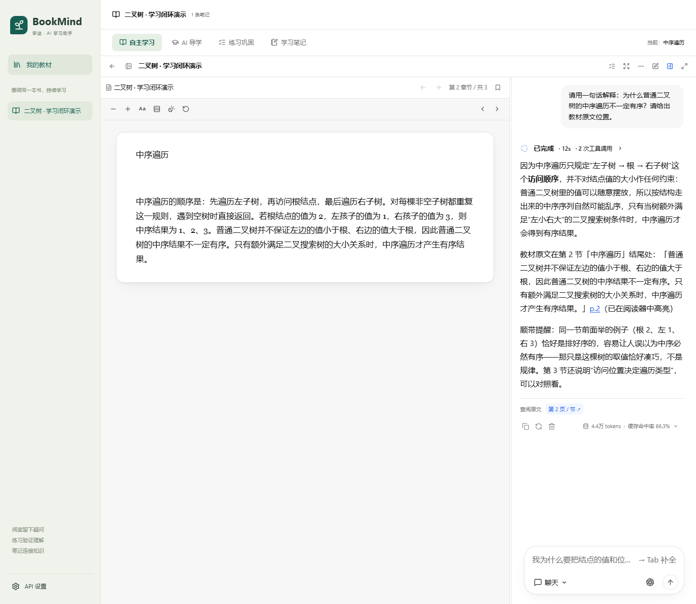
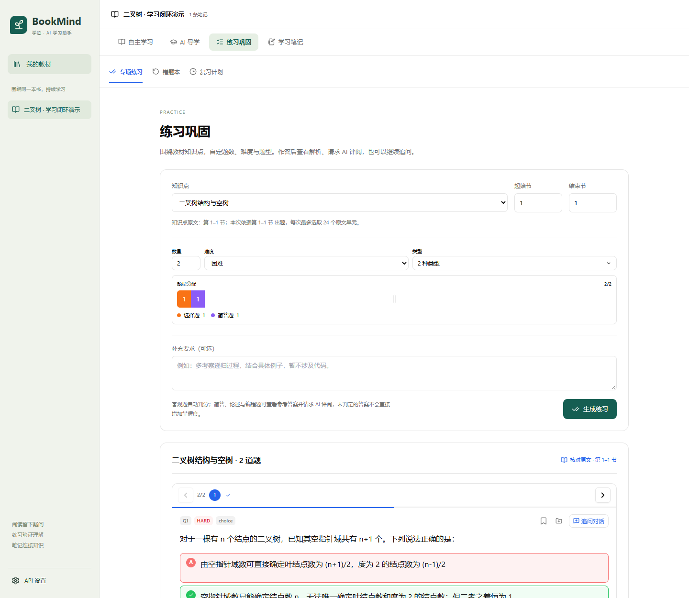
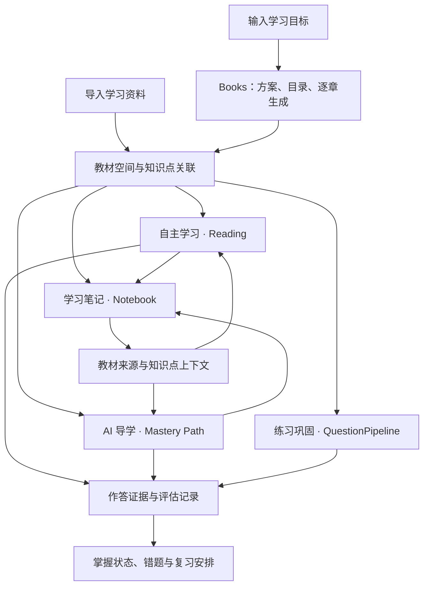

<p align="center">
  
</p>

<h1 align="center">BookMind · 学迹</h1>

<p align="center"><strong>从一份资料或一个目标出发，读懂、练会、记下来。</strong></p>

<p align="center">
  <a href="LICENSE"></a>
  
  
  
</p>

<p align="center">
  <a href="#核心功能">核心功能</a> ·
  <a href="#界面预览">界面预览</a> ·
  <a href="#快速开始">快速开始</a> ·
  <a href="#技术架构">技术架构</a> ·
  <a href="#开发与文档">开发与文档</a>
</p>

BookMind 是面向教材自学与目标学习的 AI 学习助手。导入一本教材，或告诉 AI 你想学什么，就可以在同一个学习空间里阅读资料、讨论疑问、接受导学、完成练习，并整理自己的笔记。

项目将 **自主学习、AI 导学、练习巩固、学习笔记** 放在同一本教材、同一组知识点下。学习模式各自保留对话，作答证据与复习安排相互关联，让一次提问、一道错题和一条笔记能够回到具体的学习内容。

BookMind 基于 [HKUDS/DeepTutor](https://github.com/HKUDS/DeepTutor) 开发，围绕资料学习场景整合 Reading、Mastery Path、Books 与 Notebook 等模块，采用 Next.js + FastAPI，当前主要验证 Windows 本地运行。

## 两个学习起点

| 你手上有什么 | 如何开始 | 最终进入 |
| --- | --- | --- |
| **已有资料** | 导入 PDF、EPUB、Markdown 或 TXT，建立教材空间与学习目标 | 阅读器、AI 导学、专项练习与本书笔记 |
| **已有目标** | 描述想学什么和已有基础，确认 AI 拟定的方案与目录，逐章生成学习资料 | 将完整资料加入书架，使用同一套学习功能 |

目标生成支持精简、标准、深入三种深度。方案和目录可编辑，编写任务支持暂停、继续及未完成章节重试；生成完成后可下载 Markdown，也可直接开始学习。

## 核心功能

### 自主学习：带着问题读资料

- 在阅读器中查看原文、浏览目录、保留阅读位置、划选和标注。
- 围绕当前内容提问，请 AI 解释概念、补充例子或进行比较。
- 使用文字模型生成结构图、流程图、思维导图等图解，帮助理解抽象内容。
- 学习过程中可调用随堂小测；有来源定位的内容可返回原文核对。

### AI 导学：沿着知识点逐步理解

- 将教材目录组织成可编辑的学习路径，围绕具体知识点展开教学对话。
- 通过讲解、追问、随堂测验与反馈，引导学习者说明自己的理解。
- 使用「随堂测验」「图解说明」「补充示例」继续当前学习。
- 随时打开教材原文侧栏，核对导学实际查阅的来源。

### 练习巩固：配置一组练习，再针对薄弱处复习

- 选择教材知识点与原文范围，设置 **1–50 道题**、难度、题型及题型数量配比。
- 支持选择、判断、填空、简答、论述、编程六种题型。
- 客观题判分，主观题支持 AI 评阅与题目追问。
- 在同一本书内查看错题与复习计划，作答记录关联到对应知识点。

### 学习笔记：把理解留在教材旁边

- 将学习中的摘录、解释与总结保存到本书笔记本。
- 保留教材、知识点与原文位置的关联，方便再次查阅。
- 支持笔记编辑、搜索、总结和 Markdown 导出。
- 相关笔记可作为后续学习的上下文；文字笔记与图解文件分别保存。

## 界面预览

以下为本地运行界面，使用专用二叉树演示资料与演示作答，不代表真实学生的学习成绩。

**自主学习：原文与讨论并排，边读边问。**



**练习巩固：按知识点配置题目，作答后查看反馈。**



## 一次完整的学习过程

以数据结构中的「二叉树」为例：

1. 导入课程资料，或者输入「我想学懂二叉树」，生成一份学习资料。
2. 在自主学习中阅读定义，询问「为什么普通二叉树不保证左小右大」，结合原文与图解理解。
3. 进入 AI 导学，沿知识点接受讲解、回答问题，再根据反馈补充理解。
4. 在练习巩固中配置不同题型，查看解析，对不理解的题继续追问。
5. 将关键解释整理成笔记；之后从本书错题与复习计划继续学习。

四个页面共享教材和知识点关联。**自主学习、AI 导学与专项练习的会话彼此独立**，切换页面可继续对应会话；练习生成记录不会混进阅读聊天。

阅读、提问或保存笔记属于学习过程记录，掌握度依据作答证据与评估规则更新，一道题答对不会直接将整章标为掌握。

## 快速开始

### 环境要求

- Windows、Git、Python **3.11–3.14**、Node.js **22+** 与 npm。
- 首次启动需要网络下载依赖并构建前端。
- 一个支持工具调用、兼容 Chat Completions 的文字模型服务。主学习流程无需单独配置嵌入模型。

### 下载并启动

在 PowerShell 中运行：

```powershell
git clone https://github.com/T-RexWarrior/bookmind.git BookMind
cd BookMind
powershell -ExecutionPolicy Bypass -File .\start.ps1
```

也可以双击项目中的 **启动BookMind.cmd**。启动脚本会创建本地 Python 环境、安装依赖、初始化配置并启动服务：

| 服务 | 地址 |
| --- | --- |
| BookMind 页面 | http://127.0.0.1:8018 |
| 后端服务 | http://127.0.0.1:8019 |

在左下角 **API 设置** 中填写服务地址、模型名称与 API Key，保存后测试连接。随后在「我的教材」选择导入资料或从目标生成内容。

```powershell
# 启动服务，不自动打开浏览器
powershell -ExecutionPolicy Bypass -File .\start.ps1 -NoBrowser

# 修改前端后重新构建
powershell -ExecutionPolicy Bypass -File .\start.ps1 -Rebuild

# 停止本项目服务
powershell -ExecutionPolicy Bypass -File .\stop.ps1
```

资料、笔记、学习记录和模型配置保存在本机 `data/`。调用模型时，相关原文与对话会发送至配置的模型服务。`data/`、API 密钥、本地依赖与缓存均不进入源码仓库。

## 技术架构



| 层次 | 实现 |
| --- | --- |
| 前端 | Next.js、React、TypeScript、Tailwind CSS；PDF.js 阅读与交互式题卡 |
| API 与会话 | FastAPI、WebSocket、持久化会话与流式执行 |
| 学习模块 | Reading、Mastery Path、Books、Notebook、QuestionPipeline |
| 资料与记录 | 本地文件、SQLite、学习目标、作答证据与复习调度 |
| 模型与图解 | 可配置文字模型；SVG、Chart.js、Mermaid、思维导图与 HTML |

BookMind 的教材关联层维护资料、阅读工作区、学习路径与笔记本之间的对应关系，复用原有评估与存储机制。内部保留 `deeptutor` 包名、导入路径和部分存储键，以兼容所复用的运行时。

### 当前范围

- 当前主要支持有可提取文字的资料；扫描件可以显示 PDF，基于原文的问答仍需要可用文本。
- 初始学习路径主要依据目录建立，可继续编辑与细化，不代表模型已经逐页分析整本教材。
- 检索主要使用目录、按页读取与文本搜索；专项练习每次选取同一知识点内最多 24 个原文单元。
- 当前聚焦文字模型与代码图解。联网搜索、论文库、图像生成、语音与视频服务尚未开放。

## 开发与文档

```text
BookMind/
├── deeptutor/
│   ├── bookmind/             教材关联、练习范围、目标资料导入与会话隔离
│   ├── reading/              资料解析、原文、标注与阅读位置
│   ├── learning/             知识点、作答证据、掌握规则与复习调度
│   ├── book/                 学习方案、目录与资料编写
│   ├── capabilities/         阅读、导学与出题等 Agent 能力
│   ├── services/             会话、模型配置与笔记服务
│   └── api/routers/          API 与流式接口
├── web/                      Next.js 页面、阅读器、题卡与笔记界面
├── scripts/                  启动、初始化与迁移脚本
├── tests/                    BookMind 模块集成测试
└── docs/                     架构、开发与功能说明
```

- [开发、数据与迁移](docs/README.native.md)
- [模块关联与学习记录](docs/原版模块融合说明.md)
- [自主学习、AI 导学与练习设计](docs/AI导学改版说明.md)
- [从目标生成学习资料](docs/目标学习说明.md)
- [早期版本问题快照](docs/当前版本问题清单.md)

验证覆盖教材关联、来源范围、会话隔离、练习配置、判分、重复提交、笔记与复习规则。运行命令和浏览器联调方式见开发文档；普通构建与单元测试不调用付费模型，真实模型联调需手动执行。

## 致谢与许可证

BookMind 基于 [HKUDS/DeepTutor](https://github.com/HKUDS/DeepTutor) 的 [a31d826](https://github.com/HKUDS/DeepTutor/commit/a31d82624c27d75f4e771d4fcb78dce16470b383) 源码进行场景整合与修改，复用其阅读、导学、资料生成、练习、笔记和会话运行时，保留原始版权与第三方声明。

本项目使用 [Apache License 2.0](LICENSE)。来源与第三方说明见 [NOTICE](NOTICE) 和 [THIRD_PARTY_NOTICES.md](THIRD_PARTY_NOTICES.md)。
