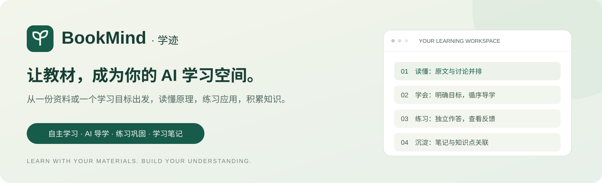
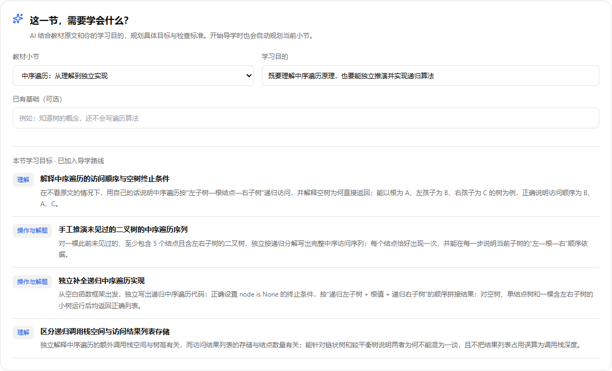

<p align="center">
  
</p>

<p align="center">
  <strong>AI 教材学习助手 · 从阅读与理解，到练习与积累</strong>
</p>

<p align="center">
  <a href="LICENSE"></a>
  
  
  
</p>

<p align="center">
  <a href="#项目介绍">项目介绍</a> ·
  <a href="#功能预览">功能预览</a> ·
  <a href="#核心能力">核心能力</a> ·
  <a href="#快速开始">快速开始</a> ·
  <a href="docs/architecture.md">架构文档</a>
</p>

## 项目介绍

**BookMind（学迹）是一款围绕教材与学习目标展开的 AI 学习助手。**

导入一份资料，BookMind 将原文阅读、AI 导学、练习巩固与学习笔记连接到同一组知识点；也可以先提出一个学习目标，由 AI 组织并生成学习资料，再进入相同的学习过程。

阅读时有疑问，可以结合原文讨论、查看图解；准备深入学习，可以让 AI 明确本节要学会什么，循序讲解并检查理解；完成学习后，可以通过专项练习发现薄弱处，再把自己的理解整理进笔记。

**资料有出处，目标有要求，练习有反馈，学习有记录。**

## 功能预览

### 阅读与讨论，在同一个学习空间

原文与 AI 对话并排显示。围绕当前资料提问，结合可定位的原文引用、示例和图解理解内容。


### 学习目标，有明确的掌握要求

同一小节可以包含理解原理、手工推演、独立实现等不同目标。AI 结合原文和学习目的规划目标，并说明每个目标怎样才算学会。



### 按知识点练习，查看作答与解析

选择知识点、原文范围、题量、难度和题型。作答后查看反馈，继续追问，并在错题本和复习计划中回到薄弱处。


## 核心能力

<table>
<tr>
<td width="50%" valign="top">

### 📖 自主学习

- 阅读教材或文档，定位章节与原文。
- 结合当前资料讨论疑问、补充示例。
- 用 SVG、Mermaid 等图解辅助理解。
- 从引用返回来源，联系相关笔记。

</td>
<td width="50%" valign="top">

### 🧭 AI 导学

- 根据教材原文、学习目的与已有基础规划目标。
- 区分记忆、概念理解、步骤技能与设计判断。
- 给出可检查的掌握要求，按目标循序讲解。
- 通过追问、随堂测验与解释记录理解情况。

</td>
</tr>
<tr>
<td width="50%" valign="top">

### ✍️ 练习巩固

- 自选知识点、难度、题量与题型组合。
- 客观题判分，主观题请求 AI 评阅。
- 保存错题，查看解析并继续讨论。
- 将有效作答汇入同一份学习记录与复习计划。

</td>
<td width="50%" valign="top">

### 📝 学习笔记

- 保存原文摘录、讨论总结与自己的理解。
- 关联教材位置和知识点。
- 阅读、导学与练习之后继续补充整理。
- 回到原文或相关学习目标，延续学习。

</td>
</tr>
</table>

### 从目标生成学习资料

还没有教材时，可以描述想学什么。AI 会提出学习方案、组织目录并生成章节内容；生成结果可导入学习空间，继续阅读、讨论、练习和记录笔记。

### 同一份资料，连贯的学习过程

以“学习二叉树”为例：

1. **读原文**：查看教材定义与示例，讨论不理解的地方。
2. **明确目标**：让 AI 区分“解释结构”“推演遍历”“实现算法”等要求。
3. **接受导学**：围绕选定目标讲解、追问并检查理解。
4. **独立练习**：完成对应题目，根据反馈回看原文与错题。
5. **整理笔记**：保存自己的解释，关联教材位置与知识点。

四个模块共享教材、知识点与学习记录，各自保留独立对话。已有作答和笔记关联会在学习目标规划时保留。

## 快速开始

**环境要求**：Python 3.11–3.14、Node.js 22+，以及支持工具调用的文字模型 API。

```powershell
git clone https://github.com/T-RexWarrior/bookmind.git
cd bookmind
powershell -ExecutionPolicy Bypass -File .\start.ps1
```

首次启动会安装依赖并构建前端。打开 **http://127.0.0.1:8018**：

1. 在 **API 设置** 中填写 API 地址、模型名称与密钥，测试连接。
2. 在 **我的教材** 中导入资料，或通过学习目标生成资料。
3. 进入 **自主学习** 或 **AI 导学**，开始学习。

AI 导学按当前小节读取原文并规划目标，也支持先预览目标再采用。教材学习与文字图解不要求额外配置嵌入模型或图像生成服务。

一键启动脚本用于 Windows；手动安装、开发启动与配置方式见[安装与开发](docs/development.md)。

## 文档与反馈

| 入口 | 内容 |
| --- | --- |
| [安装与开发](docs/development.md) | 环境配置、手动启动、数据目录与开发验证 |
| [架构说明](docs/architecture.md) | 模块职责、教材关联与学习数据流 |
| [GitHub Issues](https://github.com/T-RexWarrior/bookmind/issues) | 问题反馈与功能建议 |

## 开源与致谢

BookMind 基于 [HKUDS/DeepTutor](https://github.com/HKUDS/DeepTutor) 开发，复用并改造其阅读、导学、资料生成、练习、笔记与会话引擎，聚焦教材自学与目标学习场景。

本项目采用 [Apache License 2.0](LICENSE)。原始版权与第三方声明见 [NOTICE](NOTICE) 和 [THIRD_PARTY_NOTICES.md](THIRD_PARTY_NOTICES.md)。
