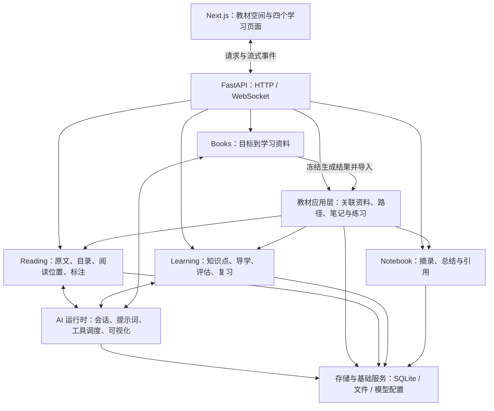

# BookMind 架构

BookMind 是一个按业务划分模块的单体应用：Next.js 负责交互，FastAPI 负责接口与流式通信，Python 学习引擎负责阅读、导学、出题和资料生成。它们运行在同一个后端进程中，通过明确的接口协作。

## 一张图理解整体



教材应用层保存的是“谁和谁属于同一本教材”的关系。它不复制原文、不重新保存一份笔记，也不另算一套掌握分数。

书架删除采用可恢复的移除：`textbooks.removed_at` 标记教材不再展示，原文、会话、笔记和学习证据仍使用原来的 ID 保存。书架底部恢复或重新导入同一资料都会恢复原关联；已移除的 AI 生成教材不会重新出现在待生成列表中。

教材的导学路径不能通过原生主题入口单独删除；前端隐藏该入口，后端拒绝会留下悬空教材关联的删除请求。路径意外缺失时，使用教材已保存的知识点 ID、原文范围和笔记本关联重建目录，不猜测历史成绩。主页的独立生成记录可以单条删除或批量清空，归档前停止生成任务；已经导入教材的来源不在此处清理。

Books 的写作上下文由 `book/writing.py` 统一组织：学习者要求、全书目录、已建立的示例和当前章节分工传给正文、代码、图解与题目生成。章节正文预算由各 section 共享，小节再共享 section 预算。正文被模型输出上限截断时标记失败，供原生重试流程处理。新导入的 Markdown 使用富文本阅读，保留完整的图解与代码围栏，复用图解组件显示 SVG、Chart.js 和 Mermaid。已有资料不自动重切分或改变渲染格式，避免移动笔记锚点。

## 目录与职责

```text
bookmind/
├── main.py              # 对外唯一 ASGI 入口
├── api/
│   ├── main.py          # 创建应用、中间件、健康检查
│   ├── lifecycle.py     # 启动、恢复未完成任务、关闭资源
│   ├── routes.py        # 明确注册当前产品使用的接口
│   └── routers/         # HTTP / WebSocket 适配器
├── textbook/
│   ├── router.py        # 教材入口与模型设置接口
│   ├── service.py       # 教材关联与学习概览
│   ├── repository.py    # 教材关联数据库
│   ├── curriculum.py    # 目录转知识点与原文范围
│   ├── planning.py      # 按原文与学习目的规划目标、类型和掌握要求
│   ├── practice.py      # 专项练习的会话、配置与来源绑定
│   ├── generated.py     # 生成资料导入
│   ├── session_scope.py # 阻止三种学习会话相互串用
│   └── study_diagrams.py# 阅读与导学中的内联图解
├── reading/             # 原文处理、阅读状态、标注与阅读工具
├── learning/            # 知识点、评估证据、掌握记录与复习调度
├── book/                # 资料提案、目录、章节生成与导出
├── app/                 # 应用容器与统一执行入口
├── agents/              # 对话、出题等 Agent 执行循环
├── capabilities/        # 阅读、导学等可调用能力
├── runtime/             # 工具注册、任务协调、事件与恢复
├── services/            # 会话、笔记、模型、配置与文件服务
├── visualizers/         # SVG、Mermaid、图表等渲染协议
└── compat.py            # 旧部署配置兼容边界
bookmind_cli/            # 复用同一后端的命令行入口
bookmind_web/            # 打包前端资源的 Python 包
web/                     # Next.js 前端、交互组件与前端测试
scripts/                 # 启动、初始化和数据迁移
tests/                   # 后端集成与行为测试
docs/                    # 架构、开发与公开演示截图
data/                    # 本机数据，不进入 Git
```

## 四个页面怎样协作

一个教材有固定的 `material_id`、阅读工作区 `workspace_id`、学习路径 `path_id` 和笔记本 `notebook_id`。知识点保存自己的 ID 和教材位置范围，页面之间通过这些标识连接。

| 页面 | 自己负责的状态 | 与其他页面共享的内容 |
| --- | --- | --- |
| 自主学习 | 阅读位置、标注、阅读对话 | 教材、知识点、来源与笔记 |
| AI 导学 | 当前导学位置、导学对话 | 知识点、评估证据与掌握记录 |
| 练习巩固 | 出题配置、题组、专项练习对话 | 原文范围、作答记录、错题与复习状态 |
| 学习笔记 | 笔记内容和引用关系 | 教材位置、相关知识点 |

例如学习“二叉树”：阅读页读取对应原文；导学围绕同一个知识点讲解；练习使用该知识点的原文范围出题；有效评估写入同一份学习记录；笔记保存教材与知识点引用。切回阅读页时仍看到阅读对话，练习对话留在练习页。

## 一次提问的实际路径

教材导入后，目录首先提供原文定位，标为“待规划”，不把所有小节当作只需概念理解。
开始导学时，`mastery_prepare_lesson` 为当前小节读取有界的原文窗口，结合学习目的与已有基础自动规划学习目标，无需在导学首页另填表单。
每个目标有独立的类型（记忆、概念、步骤技能、设计判断）、可检查的掌握要求和原文来源。它们不是四级难度，模型不需要凑齐四种类型。

规划按小节按需进行，避免导入长篇教材时等待整本分析。预览不会改变学习进度；采用时检查教材内容和路径版本，并与导学运行互斥。
已有作答、解释、掌握记录、复习历史、待答题目或笔记引用的原目标会保留，新目标使用独立 ID，不继承旧成绩。
没有学习记录的目录占位可作为第一个正式目标保留 ID，其他目标新增。保存或调整未变化的路线时，保留掌握要求与来源分组。

1. 前端提交消息、当前教材和学习模式。
2. 后端验证会话归属，整理经过验证的上下文。
3. 对应能力调用文字模型，模型按需使用原文搜索、读取、出题或图解工具。
4. 工具返回结构化结果：原文片段带位置，图解带渲染类型与内容，题目带可保存的题组标识。
5. 后端保存会话与事件；前端按流式事件显示文字、引用、图解和答题卡。

读取教材的核心路径使用目录、定位和原文工具；当前教材学习流程不要求配置嵌入模型。保留的 RAG 适配器属于可选扩展，不能把它们的安装依赖或代码存在理解为当前已经接入了向量检索。

## 本次重构与后续空间

已完成：统一 Python 包、CLI、环境变量与浏览器存储命名；拆分应用启动和路由装配；将教材 SQL、目录转换、业务编排分开；将模型设置从 HTTP 路由中提取，供初始化脚本复用；取消未启用渠道和定时任务的启动装配；保留任务恢复与资源关闭。

尚可继续优化：

- **依赖裁剪**：当前仍保留上游的可选集成源码与较宽的安装依赖，下一步可按阅读、生成、检索和外部服务拆分安装组，并用干净环境逐组验证。
- **减少反向依赖**：部分学习引擎仍直接调用教材关联函数，可逐步改成应用容器注入的查询接口，减少领域模块之间的相互导入。
- **统一内容来源接口**：阅读、生成资料和未来外部资料可共享“目录、片段、定位、引用”接口，使新来源接入不需要修改每个学习页面。
- **跨存储一致性**：教材绑定目前通过稳定 ID、进程锁和幂等恢复连接多个原生存储。若要多进程并发写入，应增加数据库级协调或持久化的绑定任务，而不是只依赖进程锁。
- **前端资源整理**：未显示的原版页面与组件还保留在源码中，可在明确未来范围后逐项解除依赖并移除。

当前规模下，优先把模块边界和共享数据关系理清。微服务拆分会引入更多部署与一致性成本，没有必要为了目录整齐而引入。
