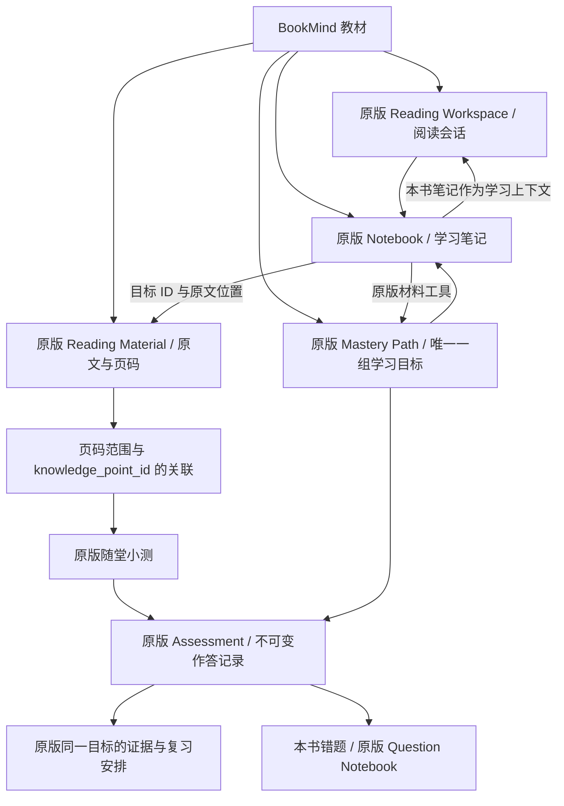

# Reading、Mastery Path 与笔记的融合

这次采用复制 BookMind 源码后删减的路线。阅读器、Agent 循环、学习证据、掌握规则、复习调度、笔记服务和主要操作界面继续使用原版实现。

## 一份教材的共同身份

新增数据库只保存 `material_id / workspace_id / path_id / notebook_id` 和原文范围，不保存第二套掌握分数。页面切换只切换工作方式。

## 关键改动

- `bookmind/textbook/service.py`：幂等建立关联，按教材目录初始化原版目标，提供页码与目标的确定关联。路线编辑后的目标只有带明确原文来源才继承定位，不凭名字猜测。
- `reading_extensions.py`：随堂小测在服务端绑定目标，调用原版统一 assessment 记录；正确答案只存于服务端，提交前不返回。
- `learning/topic_materials.py`：增加 Reading 原文来源，供原版 Mastery 的材料工具读取。
- `capabilities/mastery/loop.py`：将原版 `material_outline / search_material / read_material` 工具接入路径，服务端固定当前教材。读取其他章节不依赖把整本书塞入提示词，也不要求额外配置 embedding。
- `services/session/turns/executor.py`：阅读时自动带入本书当前目标或教材级笔记，继续使用原版笔记上下文处理。
- `services/notebook/service.py`：保存时补充经当前笔记本核对的教材、目标与来源。笔记仍由原版服务保存和编辑。
- `web/components/bookmind/`：只新增教材书架、三个页面的共同上下文、设置和按本书筛选的错题容器；题卡、复练和笔记编辑保留原版组件。

## 判断学习状态的边界

阅读位置、提问和笔记是学习过程。掌握与复习证据来自作答，仍执行原版的定量/定性验证与重复提交规则。一个小测答对会产生证据和复习安排，不会直接把整个章节标成掌握。

初始目录是目标骨架；细化目标时需要保留来源关系。扫描件缺少可提取文字时，可以查看原版 PDF，文字模型无法仅凭扫描图获得原文事实。
