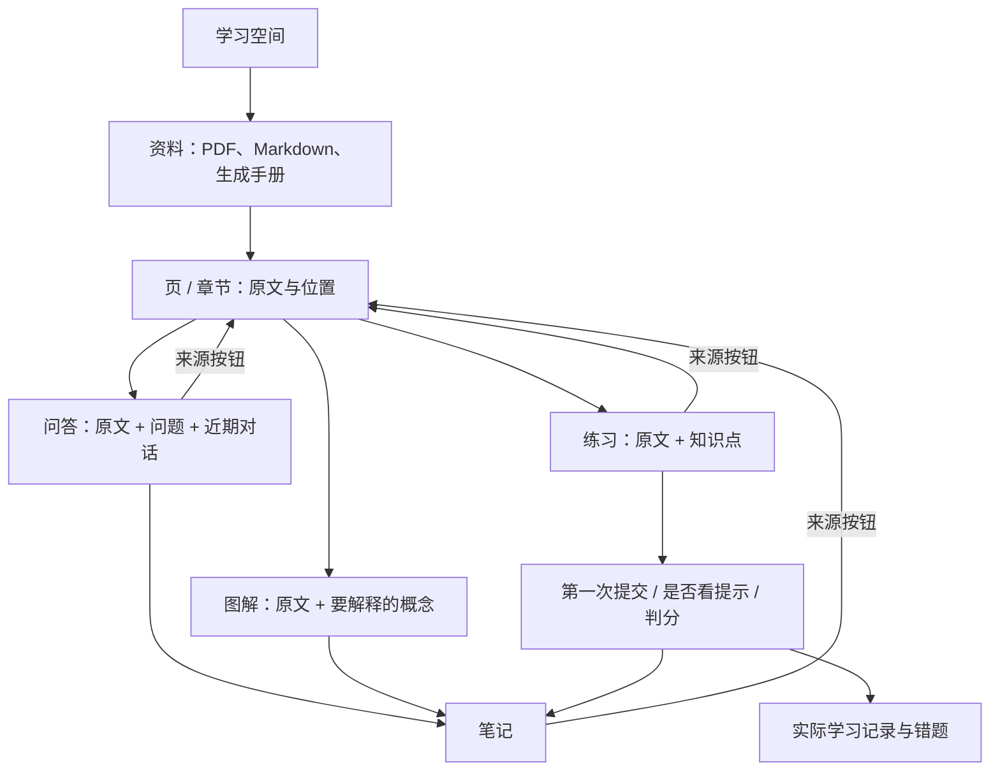
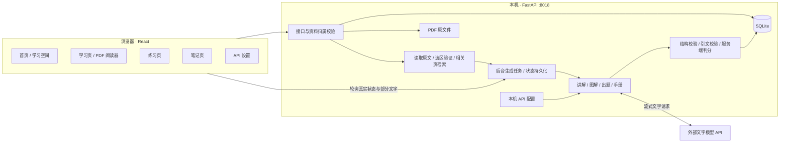

# 第一版架构与 DeepTutor 的关系

## 一条能走通的学习主线

先建学习空间。空间里有资料，资料有页或章节。学生阅读某一页时，问答、画图和出题都带着这份资料的 ID 与页码去后端。后端从本机数据库读取原文，而不是相信浏览器随意传来一段“教材内容”。

回答、图解和练习保存时，都保留原来的资料位置。笔记再保存这些内容时，也继承来源。于是，练习里做错了可以回到原文；原文里的疑问可以得到讲解；讲解和图解可以变成笔记。切换页面是换工作方式，资料关系仍在。

## 运行架构

前端构建后由 FastAPI 一并提供。无需再启动 Docker、Redis、向量数据库或独立工作队列。

## 为什么没有把整个 DeepTutor 复制过来

采用了任务中允许的“参考源码重写”路线。原项目的科研检索、联网工具、多智能体工作流、多模态与复杂知识库系统，会让这次的教材学习场景承担大量无关依赖。

这版实际复用 `deeptutor/reading/_grounding.py`，放在 `backend/app/vendor/deeptutor_grounding.py`。它负责清理文本差异、验证选区、以选区为中心截取原文、匹配引文。文件来源与 Apache 2.0 许可证已保留。

其他功能参考其实现思路，重新设计了存储表、接口、固定学习任务与前端：

| DeepTutor 中参考的部分 | 本项目如何处理 |
| --- | --- |
| Reading 页面与原文上下文 | 同一资料下按页/章节阅读，后端决定实际原文窗口 |
| Reading extensions 中的测验与来源 | 原文依据校验；未提交题目隐藏答案；判分放在服务端 |
| Visualize 的文本图解能力 | 简化为 Mermaid / 静态 SVG / 结构化分步图，不执行任意 HTML/JavaScript |
| Notebook 的保存与来源字段 | 独立笔记页，继承资料/页码/对话/图解/练习的 ID |
| 异步生成与任务结果 | SQLite 任务状态 + 本进程异步执行 + 前端轮询 |
| 完整 RAG 与 Agent runtime | 第一版使用关键词检索与固定任务，不依赖整个框架 |

## 关键数据之间怎么连

| 数据 | 关键关系 | 为什么需要 |
| --- | --- | --- |
| space | 一个学习空间包含多份资料 | 课程、主题或学习目标之间互不混淆 |
| material | `space_id`，原文件哈希 | 限定资料归属，识别重复上传 |
| page | `material_id + number` | 精确回到原文；PDF 使用物理页码 |
| message | `space_id + refs[]` | 回答能跳回实际提供的原文位置 |
| artifact | `space_id + refs[] + payload` | 图解可复用、重播，保留来源 |
| quiz / question | 来源、原文哈希、各题原文依据 | 出题范围固定，不随阅读器后来翻页而改变 |
| attempt | `quiz_id + question_id` 唯一 | 网络重试不重复计分，首次提交固定 |
| hint | `quiz_id + question_id` | 区分独立完成与提示后完成 |
| note | `source` 中保存原对象 ID | 笔记可展示原图解并回到资料 |
| job | `space_id + kind + status + result` | 切页继续生成，刷新可重新找到进行中的任务 |

## 具体接口按用户动作理解

所有学习接口都在 `/api/spaces/{sid}` 下。

| 用户动作 | 接口 | 核心处理 |
| --- | --- | --- |
| 建空间 | `POST /api/spaces` | 创建空间记录 |
| 上传 | `POST .../materials` | PDF 按物理页提取，文字文件按标题分节 |
| 看原文 | `GET .../materials/{mid}/pages/{page}`，`GET /files/{sid}/{mid}` | 提取文字用于上下文，PDF 原文件用于画布阅读 |
| 翻页 | `PUT .../focus` | 保存资料与页码，前端写入顺序排队 |
| 问问题 | `POST .../chat` | 读原文、检索、模型流式讲解、保存消息 |
| 画图 | `POST .../visualize` | 结构化生成、校验、保存图解和对话 |
| 从目标学习 | `POST .../handbook` | 生成短手册，存成新的资料与章节 |
| 出题 | `POST .../quizzes` | 检查格式，核验引文，隐藏答案返回 |
| 看提示 | `POST .../quizzes/{qid}/hints/{question_id}` | 保存提示事件，返回思路 |
| 提交 | `POST .../quizzes/{qid}/answer` | 根据服务端答案判分，保存第一次提交 |
| 学习记录 | `GET .../progress` | 从真实提交计算，不让模型猜掌握程度 |
| 保存/修改笔记 | `POST .../notes`，`PUT .../notes/{nid}` | 检查来源属于当前空间，再保存 |
| 看生成进度 | `GET .../jobs/{jid}` | 返回真实阶段、部分讲解、结果或错误 |
| API 配置 | `GET/PUT /api/settings`，`POST /api/settings/test` | 后端保存密钥，测试实际模型回复 |

## 第一版适合继续改什么

先以一门大学课程的一章资料打磨使用体验，验证图解和题目的准确性。之后再按需要增加：资料整理/重命名、手册逐章生成、选择题之外的题型、更可靠的知识点编号与长期复习、语义检索。图像、语音和班级管理可以分别接入，不需要推倒当前的资料与来源关系。
